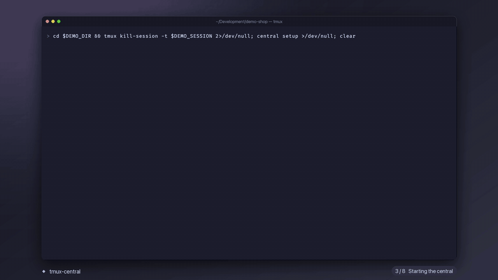

# tmux-central

LLM subagents as **visible tmux windows**, coordinated by a **central** (a Claude Code session) through an MCP server. Instead of hidden background subagents, each subagent is a tmux window you can jump into and talk to directly, and the central is notified automatically when one of them asks a question, presents a plan, needs a permission or finishes.



```
◆ central   ● [#1] TG-123   ? [#2 | #3] TG-456 | TG-457   ✓ [#4] api docs   ⚙ web      ◆ 1● 1? 1✓ 1⚙ 14:02
```

| Icon | Meaning |
|---|---|
| `○` | starting |
| `●` | working |
| `?` | waiting for you (permission, question or plan) |
| `✓` | finished its turn or reported `done` |
| `!` | reported `blocked` |
| `✗` | the CLI exited or the window was closed |
| `⚙` | managed process (dev server, watcher) |

## Install it with your agent

> **Don't want to follow the steps by hand?** Copy the prompt in [docs/agent-install-prompt.md](docs/agent-install-prompt.md) and paste it into your coding agent (Claude Code, Codex, Cursor…). It looks for an existing clone and uses it, or clones the repository if there is none; then it installs the dependencies, runs `install.sh`, wires up tmux and checks that everything works, asking before it touches your configuration files.

## Manual installation

Requirements: `tmux` 3.2+, `node` 23.6+, `claude` (Claude Code), `jq`, `fzf` and `git`.

```sh
git clone https://github.com/AllefDouglasDev/tmux-central.git tmux-central
cd tmux-central
./install.sh
```

`install.sh` installs the npm dependencies, links `central` into `~/.local/bin`, installs the hook and the `/central:*` commands into `~/.claude`, and adds the hooks to `~/.claude/settings.json` (with a backup). For the status bar and the window picker, add this to `~/.tmux.conf`:

```tmux
set -g status-interval 5
set -g status-right '#(central status --tmux --session "#S")%T'
bind a display-popup -E -w 70% -h 50% -d '#{pane_current_path}' "central pick '#S'"
```

Details, manual hook setup and uninstalling: [docs/installation.md](docs/installation.md).

## Quick start

```sh
cd my-project
central init        # creates/attaches the project's tmux session and starts Claude as the central
```

Then just talk to the central: "create a subagent for TG-123 that…". It registers the task, spawns the subagent and the window shows up. From a Claude session already running inside tmux, `/central:init` does the same.

| Claude command | What it does |
|---|---|
| `/central:init` | makes the current session the central |
| `/central:spawn` | delegates work to a new subagent |
| `/central:subcheck` | status of every subagent |
| `/central:send a1 …` | message to a subagent |
| `/central:tasks` | lists, creates or updates local tasks |
| `/central:kill a1` | ends a subagent |

```sh
central spawn -p "prompt" --ticket TG-1 [--worktree] [--cli codex]
central subcheck            # window status
central send a1 "message"
central plan a1 approve     # or approve_manual / change "what to change"
central help                # every command
```

## Documentation

| Document | Contents |
|---|---|
| [docs/agent-install-prompt.md](docs/agent-install-prompt.md) | a prompt for your agent to install everything for you |
| [docs/installation.md](docs/installation.md) | requirements, `install.sh`, tmux, hooks, environment variables, uninstalling |
| [docs/usage.md](docs/usage.md) | workflow, alerts to the central, messages, worktrees, CLI and MCP tools |
| [docs/claude-commands.md](docs/claude-commands.md) | the `/central:*` commands and the hook, in full |
| [docs/configuration.md](docs/configuration.md) | `.central/config.json`, internals, known limitations and development |

## Development

```sh
npm run check   # tsc
npm test        # node --test (uses an isolated tmux server)
```

## License

[MIT](LICENSE)
